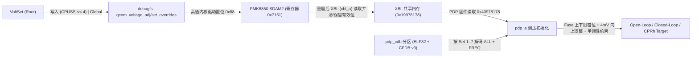

# VoltSet

面向高通 **SM8850** 平台的轻量级 Android Root 工具，基于原厂内建的 **`qcom_voltage_adj` + `pdp_cdb`** 机制，实现无需修改 `cdt` 分区、无需常驻开机脚本的 **OEM Set (1–7)** CPU 降压档位管理、设备兼容性自动检测与实时 **SCMI PERF** 计划电压对比。

> [!NOTE]
> **启发与致谢**
> 本项目在工程实现与思路上深受开发者 **washyda** 的开源项目 [**SunTuner**](https://github.com/washyda/SunTuner) 启发：
> - 借鉴了其通过 Linux 内核模块只读查询 **SCMI PERF `DESCRIBE_LEVELS`** 功耗表并反推 CPU 计划电压的实测验证方法，以及 Root 后端资产原子部署、文件锁与 `boot_id` 防错重入设计；
> - 复用了 **SunTuner** 以 `GPL-2.0-only` 协议开源的只读 SCMI 查询内核模块 `qcom-scmi-ro.c` 及预编译 `.ko` 二进制（对应源码、Kbuild `Makefile` 与完整许可证随附于 [`kernel/`](kernel/) 目录）。
> - 在此基础上，VoltSet 针对 SM8850 固件暴露出的 `qcom_voltage_adj` → `PMK8850 SDAM2` → `pdp_cdb` 原生链路做了完整逆向与动态解析实现。
> - 感谢 [**articlepp/voltset-sm8850-patch**](https://github.com/articlepp/voltset-sm8850-patch)（`Apache-2.0`）发现部分 SM8850 机型（如 REDMI K100 Pro Max）开机后 `init` 未默认挂载 `debugfs` 的问题，并贡献了基于 `unshare(CLONE_NEWNS) + MS_PRIVATE` 的私有挂载命名空间思路（已原生重构并内置于 [`native/vsetns/`](native/vsetns/)）。

---

## 核心功能

- **OEM Set 1–7 档位切换与一键还原**
  - 动态扫描 `/proc/mounts` 中的 `debugfs` 挂载点（兼容 KernelSU/Magisk 随机路径）；若检测到系统 `init` 未挂载 `debugfs`（如 REDMI K100 Pro Max），自动通过内置 16K 页对齐小工具 [`vsetns`](native/vsetns/vsetns.c) 在私有 mount namespace（`CLONE_NEWNS` + `MS_PRIVATE`）内按需临时挂载 `debugfs` 并随即退出销毁，不污染宿主 `/proc/mounts`。读写 `qcom_voltage_adj/get_overrides` 与 `set_overrides`，同步交叉核对 PMIC `regmap/0-00` 寄存器 `0x7151`。
  - 每次打开或返回前台自动检测，分别显示**本次开机档推定**和 **SDAM 当前读回**。重启后比对上次由 VoltSet 写入的档位与本次首次读回，发生差异时显示待确认。
  - 待重启档位可重启核对、撤回或还原默认 Set 1。
  - **不创建任何开机自启脚本**：目标档位保存在 PMIC 硬件 SDAM2 中，重启由引导阶段自动应用。
- **`pdp_cdb` 与 `pdp` 固件双表自动动态解析（无硬编码电压表）**
  - 自动按当前 A/B 槽位读取设备自身的 `/dev/block/by-name/pdp_cdb[_a|_b]`，在 Kotlin 中完成 `ELF32 → CFDB v3 → sdbm 哈希` 解析，真实还原 `ALL` 全局基底与 `FREQ` / `PSTATE` 分频叠加值，并检测固件内是否存在强制锁死档位的 `OEM_VOLTAGE_ADJUSTMENTS_SET_OVERRIDE`。
  - **自动按体质匹配硬件限位**：同时只读读取活动槽位 `/dev/block/by-name/pdp[_a|_b]` 内的 `CFDB v3` DCVS 硬件限位表，不硬编码机型/bin 名称，通过结构体指纹与本机 SCMI 频点列表自动匹配各频点 `[floor, ceil]` 上下限。
  - **首页分机个体化范围显示**：结合本机 Set 1 原厂基线，按固件公式（`floor` 下限钳位 + `4 mV` 向上取整 + 单调递增约束）在切换前即为每个 Set 推算**本机预计实降范围**，并在生效后于首页直接展示**本机实测 SCMI 降幅**，区分「表定偏移」与「个体实降」。
- **8 项只读设备兼容性检测与全机自动探测**
  - 针对不同机型与内核环境一键检查 SoC 平台、`qcom_voltage_adj` 读写节点、`0x7151` 寄存器回读、`pdp_cdb` 有效降压条目、固件覆盖锁、CDT Key 7 风险、SCMI 模块/内核页大小匹配度及 `pdp` 硬件限位表匹配状态。
  - **跨机型路径只读自动兜底与全机探测**：当标准路径缺失时自动回退搜索 `/dev/block/platform/*/by-name` 与 `/sys/class/block/*/uevent`（`PARTNAME`）、`debugfs` 浅层调压节点、`/vendor_dlkm` / `/system_dlkm` / `/vendor` 模块目录，以及 `qcom,vadj` 平台设备对应的 SPMI `regmap` 节点；在「设备检测」页提供可折叠的**全机只读自动探测**清单，并支持一键复制完整文本诊断报告。
- **只读 CDT Key 7 (SLT+ACD) 叠加风险预警**
  - 自动只读检查 `/dev/block/by-name/cdt`（兼容全零空分区、OEM 精简 9 字节 v6 及完整 v3–v6）；若发现同时开启了 CDT Key 7，将在首页和写入确认弹窗中发出显著警告，避免双重降压导致无法开机。
- **零内核模块优先 + `.ko` 自动兜底的 SCMI 实时电压对比**
  - **优先直读 `debugfs/energy_model`**：Linux 内核 Energy Model 直接缓存了与 SCMI `DESCRIBE_LEVELS` 逐微瓦一致的 `frequency` / `power (µW)` 表，无需加载任何内核模块（零 `insmod`），原生兼容 **16K 页内核**及任意内核版本；若目标内核未开启 `energy_model`，自动回退至按操作锁临时加载、退出即 `rmmod` 的 `qcom-scmi-ro.ko`。
  - SM8850 在「SCMI 电压」页提供体质电压表。两次读取一致且整数电压换算通过后显示双簇参考分、综合分和可复制的频点表。评分规则参考 [jkHXQ 的 RMX5010-CPU-Voltage](https://github.com/jkHXQ/RMX5010-CPU-Voltage#输出与评分)，分数随当前电压计划变化。
  - 在确认处于原厂 Set 1（且 CDT Key 7 关闭）时自动记录原厂基线至 `/data/adb/voltset/persistent/stock-baseline.csv`，若本机已有 SunTuner 采集过的基线也可直接只读复用。

---

## 原理解析

### 1. 端到端硬件与固件控制链路

与早期改写 `cdt` 分区触发开机校准不同，SM8850 在高通引导与电源管理固件里原生预留了多组由厂商/平台签名的电压微调档位（`OEM_VOLTAGE_ADJUSTMENTS`），整条执行链如下：



核心关键点：
1. **为什么选择签名预设表（OEM Set）而不是直接写任意毫伏？**
   在量产熔丝锁定的 SM8850 设备上，`pdp_cdb` 受安全启动镜像签名保护；SPMI Arbiter 限制 APPS 侧直接写入 CPU Buck 调压寄存器；XPU/Stage-2 页表也隔离了 PDP/CPRh 的 MMIO 与共享内存。`qcom_voltage_adj` 是内核官方暴露且经过签名链路直达 PDP 固件的入口，不会破坏任何签名分区。
2. **生效时机与“只管换挡、不跑脚本”**
   `pdp_a` 仅在开机早期初始化 CPUSS Open-Loop / Closed-Loop 下限与 CPRh Target Quotient 时消费该索引，运行期间写入 `set_overrides` 不会热更新当前电压，需重启后生效；同时 PMIC SDAM2 在正常热重启期间由电池保持，因此无需 `service.d` 脚本重复下发。

### 2. PMK8850 SDAM2 (`0x7151`) 字节编码

驱动 `qcom_voltage_adj` 在写入 `set_overrides` 时，会对传入的 8 位数值按位或上有效标记 `0x88` 后写入 PMK8850 regmap `0x7151`：

| Bit 位 | 含义 | 说明 |
| --- | --- | --- |
| `bit[7]` | CPUSS Valid | 固定置 `1`（由驱动自动附加 `0x80`） |
| `bits[6:4]` | CPUSS Rails Set Index | `0..7`，通常有效预设为 `1..7`（决定 CPU 小核/大核 OEM Set） |
| `bit[3]` | Global Valid | 固定置 `1`（由驱动自动附加 `0x08`） |
| `bits[2:0]` | Global Rails Set Index | `0..7`，默认保持 `1` |

例如写入十进制 `33` (`(2 << 4) | 1`) 时，寄存器 `0x7151` 读回为 `0xA9`（`0x21 | 0x88`），`get_overrides` 回显 `CPUSS rails index: 2` / `Global rails index: 1`。XBL 启动若读到 `0x00` 或 `0x11` 会回退为默认 `0x99`（Set 1）。

### 3. `pdp_cdb` 二进制动态解析规则

不同机型、不同系统版本中厂商写入 `pdp_cdb` 的电压表并不相同。VoltSet 启动时直接按以下结构实时解码设备自身的分区：

1. **容器层（`ELF32 LE` → `CFDB v3`）**
   遍历 ELF32 Program Headers，定位载荷以 `0x0003DBCF`（`CFDB v3` 魔数）开头的 `PT_LOAD` 段。
2. **目录索引层（`sdbm` 哈希）**
   目录项每条 16 字节（`hash`, `offset_or_value`, `type_and_size`, `reserved`），核心哈希对应键值：
   - `0xB47A3C0B` → `OEM_VOLTAGE_ADJUSTMENTS_SET_OVERRIDE`（标量；非 `0` 时固件将无视 SDAM 选择强制锁定该 Set）
   - `0x0E675698` → `clus0.OEM_VOLTAGE_ADJUSTMENTS`（小核集群 PDP0 / CPU0–5 配置 Blob）
   - `0x7AC09099` → `clus1.OEM_VOLTAGE_ADJUSTMENTS`（大核集群 PDP1 / CPU6–7 配置 Blob）
3. **13 字节偏移记录与累加语义**
   每个集群 Blob 由若干 13 字节紧缩结构组成（遇到 `set_id == 0` 结束）：
   ```c
   struct __attribute__((packed)) oem_volt_adj_rec {
       uint32_t set_id;   // 1..7
       uint8_t  mode;     // 1 = FREQ (kHz), 2 = PSTATE (index), 3 = ALL (全频点基底)
       uint32_t value;    // kHz 频率 / P-State 编号 / mode=3 时为 0
       int16_t  cx_mv;    // CX 逻辑轨偏移 (mV)
       int16_t  mx_mv;    // MX 存储/辅助轨偏移 (mV)
   };
   ```
   **PDP 固件对同 Set 内的规则采用累加方式**：先将 `mode = 3 (ALL)` 加到全部 32 个频点槽位上，再将 `mode = 1 (FREQ)` 或 `mode = 2 (PSTATE)` **累加**到对应频点，最后受芯片自身硬件 Fuse 下限 `[floor, ceiling]` 钳位并按 4 mV 步进向上对齐与强制单调递增。

### 4. 与 CDT Key 7 (SLT+ACD) 的区别及叠加风险

- **CDT Key 7（SunTuner 方案）**：写入 `cdt` 分区开启芯片出厂 SLT+ACD 自校准流程，由开机校准程序动态测定硬件延迟与最低电压；
- **OEM Set（VoltSet 方案）**：不改动 `cdt` 分区，直接切换 `pdp_cdb` 中预置签名好的 Set 1–7 毫伏偏移。
- **严禁盲目叠加**：在 `pdp_a` 固件处理流程中，OEM Set 的 CX 偏移**会与 CDT Key 7 的校准降压叠加作用于同一频点**。一旦叠加超过体质下限且 PMIC SDAM2 在 XBL 侧没有看门狗自动回退，就可能无法进入系统。因此 VoltSet 在每次刷新与写入弹窗均加入了 CDT Key 7 只读识别告警。

### 5. SCMI 实时计划电压反推

`qcom-scmi-ro.ko` 只读查询 SCMI Performance 协议的 `DESCRIBE_LEVELS`，拿到各集群频点对应的 `indicative_freq_kHz` 与 `estimated_power_uW`。利用 SM8850 / SM8750 平台动态功耗公式：

$$\text{power\_uW} = \left\lfloor \frac{\text{coeff} \times \text{freq\_kHz} \times V_{\text{mV}}^2}{10^9} \right\rfloor$$

其中 `domain 0`（PDP0）系数 `coeff = 100`，SM8850 `domain 1`（PDP1）系数 `coeff = 150`（SM8750 为 `136`）。VoltSet 先反推电压并按 4 mV 硬件步进取整，再代回整数公式检验是否与固件返回的 `uW` 完全一致。

---

## 单机实测参考样本（Xiaomi 17 Pro / `2509FPN0BC`）

以下为一台实机（`2509FPN0BC`，SM8850，Stock 空 CDT）动态解析 `pdp_cdb_a` 得到的 7 组**表定**预设，以及结合该机自身 `pdp_a` `[floor, ceil]` 限位与 Set 1 体质基线算出的实降差异（不同机型/ROM/芯片体质会各不相同，请以本机 App 首页实时解析结果为准）：

| 档位 | 类型 | 小核 PDP0 (CPU0–5) CX / MX | 大核 PDP1 (CPU6–7) CX / MX |
| --- | --- | --- | --- |
| Set 1 | 原厂默认 | `0 / 0 mV` | `0 / 0 mV` |
| Set 2 | 全频均匀 | `ALL -12 / -6 mV` | `ALL -12 / -6 mV` |
| Set 3 | 分频曲线 | `ALL -4` + 分频最深 `-16 mV` (`MX 0`) | `ALL -8` + 分频最深 `-20 mV` (`MX 0`) |
| Set 4 | 全频均匀 | `ALL -12 / -8 mV` | `ALL -12 / -8 mV` |
| Set 5 | 分频曲线 | `ALL -4` + 分频最深 `-20 mV` (`MX 0`) | `ALL -8` + 分频最深 `-24 mV` (`MX 0`) |
| Set 6 | 全频均匀 | `ALL -20 / -12 mV` | `ALL -20 / -12 mV` |
| Set 7 | 分频曲线 | `ALL -2` + 中高频最深 `-22 mV` (`MX 0`) | `ALL -2` + 中高频最深 `-24 mV` (`MX 0`) |

切换至 **Set 2**（`0x7151 = 0xA9`）重启后的实时 SCMI 实测：
- **小核 PDP0**：`787.2–3628.8 MHz`（25/28 档）实测精准下降 `-12 mV`，`384–691.2 MHz`（3 档）因接近 Fuse 下限收敛为 `-4 mV`；
- **大核 PDP1**：`883.2–4608.0 MHz`（28/29 档）实测精准下降 `-12 mV`，最低档 `768 MHz` 收敛为 `0 mV`。

---

## 其他机型能否使用？

可直接安装 APK 并授予 Root 后打开查看（**不点击任何「应用」按钮时全程纯只读**），在底部「**设备检测**」标签页查看自动判定结果：
1. **阻塞性必要条件**：内核暴露了可读写的 `debugfs/qcom_voltage_adj/{get_overrides,set_overrides}`、设备存在包含非零降压条目的 `pdp_cdb` 分区，且 `OEM_VOLTAGE_ADJUSTMENTS_SET_OVERRIDE == 0`。
2. **可选观测条件**：首选 `debugfs/energy_model` 零模块读取电压表，因此即使在 **16K 页**或非 4K GKI 内核上只要内核开启了 Energy Model 即可正常显示实测电压与本机实降范围；仅当同时缺少 `energy_model` 且无法加载 4K `qcom-scmi-ro.ko` 时才会跳过实时电压对比，也**不影响读取 `pdp_cdb` 与切换 Set**。
3. **跨机型试水建议**：首次测试未知机型请从温和档位（`-4 ~ -12 mV`）开始，重启后核对 SDAM 索引未被引导程序重置、再结合稳定性负载测试逐步下探。

> [!WARNING]
> **风险提示**
> 修改芯片电压配置存在导致系统不稳定、死机或无法启动的风险。PMK8850 SDAM2 在正常重启与断电前始终保持，且 XBL 引导程序**没有**针对 `0x7151` 的死机看门狗自动回退机制；作者与贡献者不对因使用本工具导致的设备异常或数据丢失负责。

---

## 本地构建

环境要求：Android SDK 36（含 `build-tools/36.0.0`）与 JDK 17+，在 `local.properties` 配置 `sdk.dir` 后执行：

> `native/vsetns/` 已随附针对 `arm64-v8a` 预编译且符合 16 KB 页大小对齐的 `vsetns` 二进制，如需使用 NDK 重建可执行 `make -C native/vsetns`。

```sh
./gradlew :app:assembleRelease :app:lintRelease
```

生成的 `app/build/outputs/apk/release/app-release-unsigned.apk` 需使用 `zipalign` 对齐并用个人密钥签名后安装：

```sh
"$ANDROID_HOME/build-tools/36.0.0/zipalign" -p -f 4 \
  app/build/outputs/apk/release/app-release-unsigned.apk app-release-aligned.apk
"$ANDROID_HOME/build-tools/36.0.0/apksigner" sign \
  --ks your-keystore.p12 --out VoltSet-signed.apk app-release-aligned.apk
```

---

## 开源协议

- VoltSet 自有 Android 应用、Kotlin/Shell 后端代码及 [`native/vsetns/`](native/vsetns/) 私有命名空间辅助程序采用 [**Apache License 2.0**](LICENSE)。
- [`kernel/`](kernel/) 目录下的 `qcom-scmi-ro.c` 及预编译内核模块衍生自 [**washyda/SunTuner**](https://github.com/washyda/SunTuner)，继续遵循 [**GNU General Public License v2.0 only (`GPL-2.0-only`)**](kernel/COPYING)。
